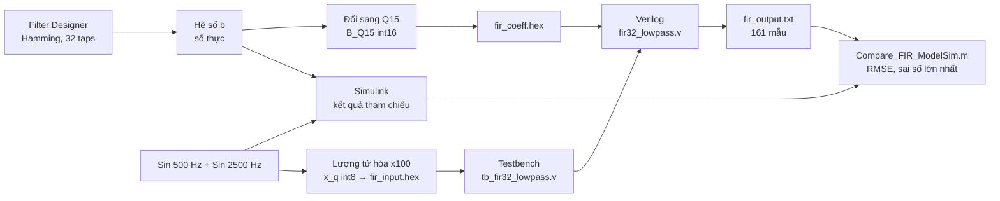

# 🎛️ Thiết kế và mô phỏng bộ lọc âm thanh thông thấp FIR

**MATLAB → Simulink → Verilog → ModelSim**

Project môn **DGT302**: thiết kế bộ lọc **FIR thông thấp 32 hệ số** bằng phương pháp cửa sổ Hamming, kiểm chứng trên **MATLAB/Simulink**, hiện thực bằng **Verilog HDL** và so sánh kết quả mô phỏng **ModelSim** với MATLAB bằng các chỉ số **RMSE** và **sai số tuyệt đối lớn nhất**.

> **Kết quả nổi bật:** 161/161 mẫu đầu ra của Verilog khớp với MATLAB, sai số lớn nhất ≈ **0,0095**, RMSE ≈ **0,0060** (nhỏ hơn 1 bước lượng tử 0,01).

**Từ khóa:** FIR, Lowpass, Hamming window, Q15, MATLAB, Simulink, Verilog HDL, ModelSim.

---

## 📑 Mục lục

1. [Giới thiệu](#1-giới-thiệu)
2. [Thông số thiết kế](#2-thông-số-thiết-kế)
3. [Quy trình thực hiện](#3-quy-trình-thực-hiện)
4. [Cấu trúc thư mục](#4-cấu-trúc-thư-mục)
5. [Lý thuyết tóm tắt](#5-lý-thuyết-tóm-tắt)
6. [Thiết kế trên MATLAB và Simulink](#6-thiết-kế-trên-matlab-và-simulink)
7. [Hiện thực Verilog và mô phỏng ModelSim](#7-hiện-thực-verilog-và-mô-phỏng-modelsim)
8. [Kết quả](#8-kết-quả)
9. [Hướng dẫn chạy lại](#9-hướng-dẫn-chạy-lại)
10. [Hạn chế và hướng phát triển](#10-hạn-chế-và-hướng-phát-triển)
11. [Thành viên và tài liệu](#11-thành-viên-và-tài-liệu)

---

## 1. Giới thiệu

Trong thực tế, tín hiệu thường lẫn nhiễu hoặc các thành phần tần số không mong muốn. **Bộ lọc FIR** (Finite Impulse Response – đáp ứng xung hữu hạn) là công cụ cơ bản để loại bỏ chúng vì:

- **Luôn ổn định:** không có phản hồi nên đầu ra không bao giờ tăng vô hạn.
- **Pha tuyến tính:** khi hệ số đối xứng, mọi thành phần tần số bị trễ như nhau nên tín hiệu không bị méo dạng.
- **Dễ làm bằng phần cứng:** chỉ cần thanh ghi trễ, phép nhân và phép cộng.

Project đi trọn một quy trình thiết kế thực tế: **tính toán phần mềm → hiện thực phần cứng mô tả → mô phỏng → so sánh với mô hình chuẩn**.

**Mục tiêu**

- Thiết kế FIR thông thấp 32 hệ số (Fs = 8 kHz, Fc = 1 kHz, cửa sổ Hamming).
- Kiểm tra bộ lọc giữ lại thành phần **500 Hz** và loại bỏ thành phần **2500 Hz** trên MATLAB/Simulink.
- Đổi hệ số sang số nguyên cố định **Q15** và dữ liệu đầu vào sang **int8** để đưa vào Verilog.
- Viết module Verilog và testbench, chạy mô phỏng **161 mẫu** trên ModelSim.
- So sánh ModelSim với MATLAB bằng đồ thị sai số, RMSE và sai số lớn nhất.

**Phạm vi:** project dừng ở mức **mô phỏng**, chưa nạp lên board FPGA thật.

| Công cụ | Dùng để làm gì |
|---|---|
| **MATLAB (Filter Designer)** | Thiết kế bộ lọc, tính hệ số, vẽ đáp ứng tần số |
| **Simulink** | Mô phỏng sơ đồ khối: 2 nguồn sin → cộng → bộ lọc → Scope |
| **Verilog** | Mô tả phần cứng bộ lọc FIR 32 hệ số và testbench |
| **ModelSim** | Chạy mô phỏng Verilog, xem dạng sóng, ghi dữ liệu đầu ra |

---

## 2. Thông số thiết kế

| Thông số | Giá trị |
|---|---|
| Loại bộ lọc | FIR thông thấp (Lowpass) |
| Phương pháp | Window Method |
| Cửa sổ | Hamming |
| Số hệ số (tap) L / bậc N | **L = 32** / N = L − 1 = 31 |
| Tần số lấy mẫu Fs | 8000 Hz (chu kỳ lấy mẫu Ts = 125 µs) |
| Tần số Nyquist | Fs/2 = 4000 Hz |
| Tần số cắt Fc | 1000 Hz (suy giảm ≈ 6 dB tại Fc) |
| Cấu trúc | Direct-Form FIR |
| Định dạng hệ số | Q15 (`int16`) |
| Định dạng đầu vào | `int8`, hệ số tỷ lệ `X_SCALE = 100` |
| Tín hiệu thử | 500 Hz (biên độ 0,7) + 2500 Hz (biên độ 0,5) |
| Thời gian mô phỏng | 0,02 s → 10 chu kỳ 500 Hz → **161 mẫu** |
| Độ trễ của bộ lọc | (L − 1)/2 = 15,5 mẫu ≈ 1,94 ms |

---

## 3. Quy trình thực hiện



---

## 4. Cấu trúc thư mục

```text
.
├── README.md                           # Tài liệu hướng dẫn đồ án
├── images/                             # Ảnh minh họa dùng trong README
├── refs/                               # Tài liệu, bài báo và sách tham khảo
│   ├── Design of FIR Filter Based on HDL Coder.pdf
│   ├── Digital FIR Filter for Audio Signal.pdf
│   ├── Discrete-Time Signal Processing.pdf
│   ├── FIR Filter for Audio Signals Based on FPGA,1999-5652-1-LE_1.pdf
│   └── Practical FIR Filter Design in MATLAB -- Losada A_R.pdf
├── report/                             # Báo cáo
│   └── DGT302_FIR_Filter.docx          # Báo cáo chi tiết (nên thêm bản .pdf)
└── src/                                # Mã nguồn thiết kế và mô phỏng
    ├── matlab/                         # MATLAB & Simulink
    │   ├── Compare_FIR_ModelSim.m      # So sánh kết quả MATLAB và ModelSim (RMSE, Emax)
    │   ├── Export_FIR_Data.m           # Xuất hệ số Q15 và dữ liệu đầu vào cho Verilog
    │   ├── Fir_Lowpass_Analysis.m      # Phân tích đáp ứng tần số, so sánh trước/sau lọc
    │   ├── Filter Coefficient.fda      # Phiên Filter Designer đã lưu
    │   ├── FIR_Lowpass_Model.slx       # Mô hình Simulink
    │   ├── FIR_Lowpass_Reference.mat   # Đáp ứng tham chiếu của MATLAB
    │   ├── FIR_Verilog_Data.mat        # B_Q15, x_q, X_SCALE
    │   ├── fir_input.hex               # 161 mẫu đầu vào (hex)
    │   └── fir_output.txt              # Bản sao kết quả ModelSim để script so sánh đọc
    └── modelsim/                       # Verilog & project ModelSim
        ├── FIR_Lowpass_Project.mpf     # File project ModelSim
        ├── FIR_Lowpass_Project.cr.mti  # Thông tin biên dịch ModelSim
        ├── fir32_lowpass.v             # Module FIR 32 hệ số
        ├── tb_fir32_lowpass.v          # Testbench
        ├── fir_coeff.hex               # 32 hệ số Q15 (hex), nạp bằng $readmemh
        ├── fir_input.hex               # 161 mẫu đầu vào cho testbench
        ├── fir_output.txt              # 161 mẫu đầu ra do testbench ghi
        └── FIR_Verilog_Data.mat        # Dữ liệu tham khảo
```

---

## 5. Lý thuyết tóm tắt

Ký hiệu: **L = 32** là số hệ số, **N = L − 1 = 31** là bậc bộ lọc.

**Phương trình FIR**

```text
y[n] = Σ b[k] · x[n−k],   k = 0 … N
```

**Đáp ứng xung lý tưởng** (tâm đối xứng α = (L−1)/2 = 15,5):

```text
h_ideal[n] = sin(2π·(Fc/Fs)·(n − α)) / (π·(n − α))
```

**Cửa sổ Hamming** (cắt đáp ứng xung về L = 32 mẫu):

```text
w[n] = 0,54 − 0,46·cos(2πn/(L−1))
b[n] = h_ideal[n] · w[n]
```

Hamming làm hệ số giảm dần về gần 0 ở hai đầu nên dải chặn "sạch" hơn (gợn sóng nhỏ), đổi lại vùng chuyển tiếp rộng hơn một chút khi giữ nguyên số tap.

**Các công thức phụ**

| Nội dung | Công thức | Giá trị trong project |
|---|---|---|
| Chu kỳ lấy mẫu | `Ts = 1/Fs` | 125 µs |
| Tần số Nyquist | `F_N = Fs/2` | 4000 Hz |
| Số chu kỳ quan sát | `N_cycles = f · T_obs` | 500 Hz × 0,02 s = 10 chu kỳ |
| Độ trễ pha tuyến tính | `n_d = (L−1)/2` | 15,5 mẫu ≈ 1,94 ms |

**Q15:** số nguyên 16 bit có dấu với 15 bit phần thập phân.

```text
B_Q15[n] = round(b[n] × 2^15)        (nhân với 32768)
b̂[n]    = B_Q15[n] / 2^15           (giá trị thực tái tạo)
```

Ví dụ: `b[0] ≈ −0,00064` → **−21**. Sau khi nhân – cộng, kết quả được **dịch phải 15 bit** để về lại đúng thang đo. Phép dịch này cắt bỏ phần lẻ nên gây sai số nhỏ.

**Chỉ số đánh giá sai số**

```text
e[n]   = y_MATLAB[n] − y_ModelSim[n]
E_max  = max |e[n]|
RMSE   = sqrt( (1/M) · Σ e[n]² )      (M = 161 mẫu)
```

---

## 6. Thiết kế trên MATLAB và Simulink

1. Dùng **Filter Designer** (`filterDesigner`) với các thông số ở mục 2, lưu thành `Filter Coefficient.fda`.
2. Xuất vector `b` (32 hệ số, đối xứng) và đổi sang `B_Q15`.
3. Tạo tín hiệu thử gồm sin 500 Hz (biên độ 0,7) và sin 2500 Hz (biên độ 0,5).
4. Mô hình Simulink gồm: **2 × Sine Wave → Sum → Discrete Filter `b(z)/1` → Scope** (Stop Time = 0,02 s).
5. Chạy `Export_FIR_Data.m` để chuẩn bị dữ liệu cho Verilog: hệ số Q15, `x_q = round(x × 100)` ở dạng `int8`, lưu `FIR_Verilog_Data.mat`, `fir_input.hex` và `FIR_Lowpass_Reference.mat` (đáp ứng tham chiếu).

**Hệ số Q15 (đối xứng):**

| Nhóm | Giá trị |
|---|---|
| 5 hệ số đầu `b[0..4]` | −21, −60, −84, −52, 78 |
| 5 hệ số cuối `b[27..31]` | 78, −52, −84, −60, −21 |

**Đáp ứng tần số:**

| Tần số | Mức suy giảm (xấp xỉ) |
|---|---|
| ≤ 500 Hz | gần 0 dB (dải thông) |
| 1000 Hz | ≈ −6 dB (tần số cắt) |
| ≥ 1500 Hz | < −50 dB (dải chặn) |
| 2500 Hz | ≈ −65 đến −67 dB |

.png)

.png)

**Nhận xét:** nếu không lọc, đỉnh tín hiệu đạt khoảng 0,7 + 0,5 = 1,2 và có dạng răng cưa. Sau lọc, tín hiệu chỉ còn sóng **500 Hz** với biên độ đỉnh ≈ 0,69; thành phần 2500 Hz gần như biến mất. Đoạn đầu (khoảng 2 ms) là giai đoạn quá độ khi bộ lọc đang "nạp đầy" 32 mẫu.

---

## 7. Hiện thực Verilog và mô phỏng ModelSim

### Module `fir32_lowpass`

Thiết kế theo kiểu **logic tuần tự**, dùng khối `always @(posedge clk or negedge rst_n)` với reset bất đồng bộ mức thấp.

| Tín hiệu | Ý nghĩa |
|---|---|
| `clk` | Xung nhịp, mỗi xung xử lý một mẫu |
| `rst_n` | Reset mức thấp, đưa các thanh ghi về 0 |
| `x_in` | Mẫu vào, số nguyên có dấu 8 bit |
| `y_out` | Mẫu ra, số nguyên có dấu 24 bit (thang ×100) |
| `h[0:31]` | 32 hệ số Q15, mỗi hệ số 16 bit có dấu, nạp từ `fir_coeff.hex` bằng `$readmemh` |
| `x0, x1, ...` | Các thanh ghi trễ 8 bit có dấu, lưu 32 mẫu vào gần nhất |
| `acc` | Bộ cộng dồn `reg signed [39:0]`, đủ rộng để không bị tràn |

Mỗi xung nhịp: **dịch mẫu → nhân với hệ số → cộng dồn vào `acc` → dịch phải số học 15 bit (`acc >>> 15`) → `y_out`**.

Ví dụ kiểm chứng trong ModelSim: `acc = 453445` → `453445 / 32768 ≈ 13,84` → cắt phần lẻ → `y_out = 13`.

### Testbench `tb_fir32_lowpass.v`

- Tạo `clk`, `rst_n`.
- Đọc `fir_input.hex` vào mảng `input_mem` bằng `$readmemh` (161 mẫu).
- Đưa từng mẫu vào `x_in` theo từng chu kỳ clock, biến `i` đếm số mẫu (cuối mô phỏng `i = 161`).
- Mở file bằng `$fopen`, ghi mỗi `y_out` ra một dòng bằng `$fdisplay` → `fir_output.txt` (đúng 161 dòng).
- In thông báo `Da xu ly xong 161 mau!` và dừng bằng `$stop`.

Hệ số trong ModelSim đã được kiểm tra bằng lệnh `examine -radix decimal` và **trùng khớp** `B_Q15` của MATLAB (`h[0] = −21`, `h[1] = −60`, `h[2] = −84`, `h[3] = −52`, `h[4] = 78`, `h[27] = 78`, …).


Tổng thời gian mô phỏng 161 mẫu: **1626 ns** (≈ 10 ns/mẫu).

**Một số giá trị đầu ra** (thang ×100):

| Vị trí | Giá trị |
|---|---|
| 11 mẫu đầu | 0, −1, −1, −1, −1, −1, 0, 0, 1, 0, −1 |
| Quá độ (mẫu 12 đến 22) | −2, −4, −3, 1, 10, 24, 40, 55, 65, 67, 58 |
| Trạng thái ổn định (lặp lại mỗi 16 mẫu) | 13, 39, 58, 69, 69, 58, 39, 13, −14, −40, −59, −70, −70, −59, −40, −14 |

Trong trạng thái ổn định, dãy số lặp lại sau **16 mẫu**, đúng với sóng 500 Hz ở Fs = 8000 Hz. Đỉnh ≈ ±0,70 khớp với biên độ ≈ 0,69 trên Scope của Simulink.

---

## 8. Kết quả

Script `Compare_FIR_ModelSim.m` đọc `fir_output.txt`, chia cho `X_SCALE = 100` rồi so với đáp ứng tham chiếu của MATLAB.

| Chỉ số | Giá trị |
|---|---|
| Số mẫu đầu vào | 161 |
| Số mẫu đầu ra ModelSim | 161 |
| Sai số tuyệt đối lớn nhất | **0,00954506** |
| RMSE | **0,00601066** |


**Nhận xét**

- Đường MATLAB (xanh) và ModelSim (đỏ nét đứt) gần như chồng khít trên toàn bộ 161 mẫu, kể cả đoạn quá độ.
- Sai số không tăng theo thời gian (không tích lũy) và lặp lại theo chu kỳ 16 mẫu của sóng 500 Hz.
- Sai số lớn nhất ≈ 0,0095 chỉ ≈ 1,4 % biên độ đầu ra (≈ 0,69) và nhỏ hơn một bước lượng tử (1/100 = 0,01). Đây là sai số lớn nhất tại **một** mẫu, không phải sai số của mọi mẫu.
- RMSE ≈ 0,0060 phản ánh sai số chung của cả 161 mẫu. Giá trị này gần với mức lý thuyết khi cắt phần lẻ một số nguyên (0,01/√3 ≈ 0,0058).
- Nguyên nhân chính: cắt phần lẻ khi dịch phải 15 bit, cùng với lượng tử hóa đầu vào (int8) và hệ số (Q15).

---

## 9. Hướng dẫn chạy lại

**Yêu cầu:** MATLAB (có Signal Processing Toolbox và Simulink, nhóm dùng R2025a) và ModelSim (nhóm dùng Intel FPGA Starter Edition 2020.1).

> 💡 Nên để project ở đường dẫn **không có dấu cách** (ví dụ `fir_lowpass`) để tránh lỗi đường dẫn trong ModelSim.

**Bước 1. Tạo dữ liệu bằng MATLAB**

```matlab
cd src/matlab
Fir_Lowpass_Analysis    % thiết kế, phân tích đáp ứng tần số
Export_FIR_Data         % xuất B_Q15, x_q, fir_input.hex, FIR_Verilog_Data.mat
```

Chép `fir_input.hex` và `fir_coeff.hex` vào thư mục `src/modelsim/` (nếu chưa có sẵn).

**Bước 2. Mô phỏng bằng ModelSim**

1. Mở project có sẵn `src/modelsim/FIR_Lowpass_Project.mpf` (hoặc tạo project mới và thêm `fir32_lowpass.v`, `tb_fir32_lowpass.v`).
2. Đảm bảo `fir_input.hex` và `fir_coeff.hex` nằm trong thư mục làm việc của ModelSim (hoặc sửa đường dẫn trong code).
3. Compile, rồi chạy mô phỏng:

```tcl
vsim work.tb_fir32_lowpass
add wave -r sim:/tb_fir32_lowpass/*
run -all
```

4. Kết quả được ghi vào `fir_output.txt` (transcript báo `Da xu ly xong 161 mau!`).

**Bước 3. So sánh kết quả**

Chép `src/modelsim/fir_output.txt` sang `src/matlab/`, rồi chạy:

```matlab
cd src/matlab
Compare_FIR_ModelSim    % in sai số lớn nhất, RMSE và vẽ đồ thị
```

---

## 10. Hạn chế và hướng phát triển

**Hạn chế**

- Mới dừng ở mô phỏng, chưa nạp lên FPGA nên chưa có số liệu tài nguyên và tốc độ.
- Chỉ thử một tín hiệu (500 Hz + 2500 Hz) và một bộ thông số.
- Đầu ra bị cắt phần lẻ (chưa làm tròn).
- Chỉ mô phỏng 161 mẫu, chưa thử với tín hiệu dài hoặc tín hiệu thực.
- Dùng 32 phép nhân song song nên tốn tài nguyên.

**Hướng phát triển**

- [ ] Thêm bước làm tròn (cộng 2¹⁴ trước khi dịch phải) để giảm sai số.
- [ ] Tăng độ rộng bit đầu vào/đầu ra.
- [ ] Tận dụng hệ số đối xứng để giảm một nửa số phép nhân.
- [ ] Thử cửa sổ khác (Hann, Blackman) hoặc tăng số hệ số.
- [ ] Viết testbench tự kiểm tra (tự so sánh, báo pass/fail).
- [ ] Tổng hợp và nạp lên FPGA, kết nối ADC/DAC với tín hiệu thật.
- [ ] Mở rộng sang bộ lọc thông cao, thông dải.

---

## 11. Thành viên và tài liệu

| Họ tên | MSSV |
|---|---|
| Trần Gia Thành | SE203763 |
| Châu Nhật Nguyên | SE203853 |
| Nguyễn Đăng Khoa | SE204014 |
| Võ Hoàng Trí | SE204383 |
| Hoàng Kiến Quốc | SE203373 |

**Giảng viên hướng dẫn:** Phạm Thế Vinh

**Tài liệu tham khảo** (các file PDF nằm trong thư mục `refs/`)

1. A. V. Oppenheim and R. W. Schafer, *Discrete-Time Signal Processing*, 3rd ed., Pearson, 2010.
2. M. A. A. Al-Dulaimi, H. A. Wahhab, and A. A. Amer, "Design and Implementation of Communication Digital FIR Filter for Audio Signals on the FPGA Platform," *Journal of Communications*, vol. 18, no. 2, pp. 89–96, Feb. 2023, doi:10.12720/jcm.18.2.89-96.
3. R. A. Losada, *Practical FIR Filter Design in MATLAB*, Rev. 1.0, The MathWorks, Inc., 2003.
4. MathWorks, *DSP System Toolbox Documentation*.
5. MathWorks, "Filter Designer," MATLAB Documentation. <https://www.mathworks.com/help/signal/ref/filterdesigner-app.html>
6. Intel Corporation, "Using the ModelSim-Intel FPGA Simulator by Drawing Waveforms," Intel FPGA University Program, Jan. 2020.
7. A. M. Sabaawi, "FIR Filter for Audio Signals Based on FPGA: Design and Implementation," *American Scientific Research Journal for Engineering, Technology, and Sciences (ASRJETS)*, vol. 24, no. 1, pp. 63–75, 2016.

Phần so sánh với các nghiên cứu liên quan được trình bày chi tiết trong báo cáo (mục 5.2).

**Giấy phép:** Dùng cho mục đích học tập.
