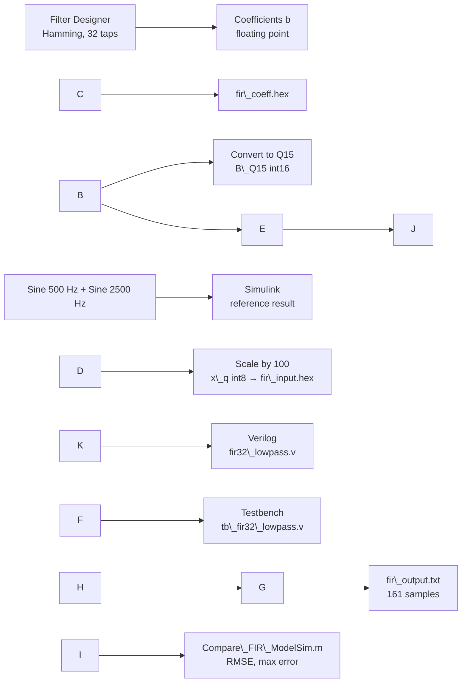

# 🎛️ MATLAB-Based Design and Verilog HDL Verification of a 32-Tap FIR Filter

**MATLAB → Simulink → Verilog → ModelSim**

Course project for **DGT302**: we design a **32-tap low-pass FIR filter** with the Hamming window method, check it in **MATLAB/Simulink**, build it in **Verilog HDL**, and compare the **ModelSim** simulation with MATLAB using two error measures: **RMSE** and **maximum absolute error**.

> \*\*Key result:\*\* All 161 output samples from Verilog match MATLAB. The maximum error is about \*\*0.0095\*\* and the RMSE is about \*\*0.0060\*\*, both smaller than one quantization step (0.01).

**Keywords:** FIR, low-pass, Hamming window, Q15, MATLAB, Simulink, Verilog HDL, ModelSim.

\---

## 📑 Table of Contents

1. [Introduction](#1-introduction)
2. [Design Specifications](#2-design-specifications)
3. [Workflow](#3-workflow)
4. [Folder Structure](#4-folder-structure)
5. [Theory Summary](#5-theory-summary)
6. [MATLAB and Simulink Design](#6-matlab-and-simulink-design)
7. [Verilog Implementation and ModelSim Simulation](#7-verilog-implementation-and-modelsim-simulation)
8. [Results](#8-results)
9. [How to Run the Project](#9-how-to-run-the-project)
10. [Limitations and Future Work](#10-limitations-and-future-work)
11. [Team and References](#11-team-and-references)

\---

## 1\. Introduction

Real signals often contain noise or unwanted frequencies. A **FIR filter** (Finite Impulse Response filter) is a basic tool for removing them, because:

* **It is always stable:** there is no feedback, so the output can never grow without limit.
* **It can have linear phase:** when the coefficients are symmetric, all frequencies are delayed by the same amount, so the signal shape is not distorted.
* **It is easy to build in hardware:** it only needs delay registers, multipliers and adders.

This project follows a complete, realistic design flow: **calculate in software → describe the hardware → simulate → compare with a reference model**.

**Goals**

* Design a 32-tap low-pass FIR filter (Fs = 8 kHz, Fc = 1 kHz, Hamming window).
* Check in MATLAB/Simulink that the filter keeps the **500 Hz** component and removes the **2500 Hz** component.
* Convert the coefficients to fixed-point **Q15** integers and the input data to **int8**, so they can be used in Verilog.
* Write a Verilog module and a testbench, then run a **161-sample** simulation in ModelSim.
* Compare ModelSim with MATLAB using an error plot, RMSE and maximum error.

**Scope:** the project stops at **simulation**. It has not been loaded onto a real FPGA board.

|Tool|What we use it for|
|-|-|
|**MATLAB (Filter Designer)**|Design the filter, calculate coefficients, plot the frequency response|
|**Simulink**|Simulate a block diagram: 2 sine sources → adder → filter → Scope|
|**Verilog**|Describe the 32-tap FIR filter hardware and the testbench|
|**ModelSim**|Run the Verilog simulation, view waveforms, write output data|

\---

## 2\. Design Specifications

|Parameter|Value|
|-|-|
|Filter type|Low-pass FIR|
|Design method|Window method|
|Window|Hamming|
|Number of taps (coefficients) L / filter order N|**L = 32** / N = L − 1 = 31|
|Sampling frequency Fs|8000 Hz (sampling period Ts = 125 µs)|
|Nyquist frequency|Fs/2 = 4000 Hz|
|Cutoff frequency Fc|1000 Hz (about 6 dB attenuation at Fc)|
|Structure|Direct-form FIR|
|Coefficient format|Q15 (`int16`)|
|Input format|`int8`, scaling factor `X\_SCALE = 100`|
|Test signal|500 Hz (amplitude 0.7) + 2500 Hz (amplitude 0.5)|
|Simulation time|0.02 s → 10 cycles of 500 Hz → **161 samples**|
|Filter delay|(L − 1)/2 = 15.5 samples ≈ 1.94 ms|

\---

## 3\. Workflow



\---

## 4\. Folder Structure

```text
.
├── README.md                           # Project guide
├── images/                             # Images used in the README
├── refs/                               # Reference papers and books
│   ├── Design of FIR Filter Based on HDL Coder.pdf
│   ├── Digital FIR Filter for Audio Signal.pdf
│   ├── Discrete-Time Signal Processing.pdf
│   ├── FIR Filter for Audio Signals Based on FPGA,1999-5652-1-LE\_1.pdf
│   └── Practical FIR Filter Design in MATLAB -- Losada A\_R.pdf
├── report/                             # Report
│   ├── DGT302\_FIR\_Filter.docx          # Full report
│   └── DGT302\_FIR\_Filter.pdf           # Full report 
└── src/                                # Design and simulation source code
    ├── matlab/                         # MATLAB \& Simulink
    │   ├── Compare\_FIR\_ModelSim.m      # Compare MATLAB and ModelSim (RMSE, Emax)
    │   ├── Export\_FIR\_Data.m           # Export Q15 coefficients and input data for Verilog
    │   ├── Fir\_Lowpass\_Analysis.m      # Frequency response and before/after filtering plots
    │   ├── Filter Coefficient.fda      # Saved Filter Designer session
    │   ├── FIR\_Lowpass\_Model.slx       # Simulink model
    │   ├── FIR\_Lowpass\_Reference.mat   # MATLAB reference output
    │   ├── FIR\_Verilog\_Data.mat        # B\_Q15, x\_q, X\_SCALE
    │   ├── fir\_input.hex               # 161 input samples (hex)
    │   └── fir\_output.txt              # Copy of the ModelSim result, read by the compare script
    └── modelsim/                       # Verilog \& ModelSim project
        ├── FIR\_Lowpass\_Project.mpf     # ModelSim project file
        ├── FIR\_Lowpass\_Project.cr.mti  # ModelSim compile information
        ├── fir32\_lowpass.v             # 32-tap FIR module
        ├── tb\_fir32\_lowpass.v          # Testbench
        ├── fir\_coeff.hex               # 32 Q15 coefficients (hex), loaded with $readmemh
        ├── fir\_input.hex               # 161 input samples for the testbench
        ├── fir\_output.txt              # 161 output samples written by the testbench
        └── FIR\_Verilog\_Data.mat        # Reference data
```

\---

## 5\. Theory Summary

Notation: **L = 32** is the number of coefficients (taps), and **N = L − 1 = 31** is the filter order.

**FIR equation**

```text
y\[n] = Σ b\[k] · x\[n−k],   k = 0 … N
```

In words: each output sample is a weighted sum of the current input sample and the previous ones. The weights `b\[k]` are the filter coefficients.

**Ideal impulse response** (center of symmetry α = (L−1)/2 = 15.5):

```text
h\_ideal\[n] = sin(2π·(Fc/Fs)·(n − α)) / (π·(n − α))
```

**Hamming window** (cuts the impulse response down to L = 32 samples):

```text
w\[n] = 0.54 − 0.46·cos(2πn/(L−1))
b\[n] = h\_ideal\[n] · w\[n]
```

The Hamming window makes the coefficients fade to almost zero at both ends. This gives a "cleaner" stopband (smaller ripples). The price is a slightly wider transition band when the number of taps stays the same.

**Other useful formulas**

|Item|Formula|Value in this project|
|-|-|-|
|Sampling period|`Ts = 1/Fs`|125 µs|
|Nyquist frequency|`F\_N = Fs/2`|4000 Hz|
|Number of observed cycles|`N\_cycles = f · T\_obs`|500 Hz × 0.02 s = 10 cycles|
|Delay of a linear-phase filter|`n\_d = (L−1)/2`|15.5 samples ≈ 1.94 ms|

**Q15:** a 16-bit signed integer with 15 bits after the binary point.

```text
B\_Q15\[n] = round(b\[n] × 2^15)        (multiply by 32768)
b̂\[n]    = B\_Q15\[n] / 2^15           (recovered real value)
```

Example: `b\[0] ≈ −0.00064` → **−21**. After multiplying and adding, the result is **shifted right by 15 bits** to bring it back to the correct scale. This shift drops the fractional part, which causes a small error.

**Error measures**

```text
e\[n]   = y\_MATLAB\[n] − y\_ModelSim\[n]
E\_max  = max |e\[n]|
RMSE   = sqrt( (1/M) · Σ e\[n]² )      (M = 161 samples)
```

\---

## 6\. MATLAB and Simulink Design

1. Use **Filter Designer** (`filterDesigner`) with the parameters in Section 2, and save the session as `Filter Coefficient.fda`.
2. Export the vector `b` (32 symmetric coefficients) and convert it to `B\_Q15`.
3. Create the test signal: a 500 Hz sine (amplitude 0.7) plus a 2500 Hz sine (amplitude 0.5).
4. The Simulink model is: **2 × Sine Wave → Sum → Discrete Filter `b(z)/1` → Scope** (Stop Time = 0.02 s).
5. Run `Export\_FIR\_Data.m` to prepare data for Verilog: Q15 coefficients, `x\_q = round(x × 100)` stored as `int8`, and the files `FIR\_Verilog\_Data.mat`, `fir\_input.hex` and `FIR\_Lowpass\_Reference.mat` (the reference output).

**Q15 coefficients (symmetric):**

|Group|Values|
|-|-|
|First 5 coefficients `b\[0..4]`|−21, −60, −84, −52, 78|
|Last 5 coefficients `b\[27..31]`|78, −52, −84, −60, −21|

**Frequency response:**

|Frequency|Attenuation (approx.)|
|-|-|
|≤ 500 Hz|close to 0 dB (passband)|
|1000 Hz|≈ −6 dB (cutoff frequency)|
|≥ 1500 Hz|< −50 dB (stopband)|
|2500 Hz|≈ −65 to −67 dB|

!\[Frequency response](https://raw.githubusercontent.com/trangiathanh/DGT302\_FIR-Filter/725a2f02a369544bc51b9098c2c59466e7433003/images/%C4%90%C3%A1p%20%E1%BB%A9ng%20t%E1%BA%A7n%20s%E1%BB%91%20(Frequency%20Response).png)

!\[Signal before and after filtering](https://raw.githubusercontent.com/trangiathanh/DGT302\_FIR-Filter/3fc7d3f9aec371c5c955f9a89530c5983aea2633/images/T%C3%ADn%20hi%E1%BB%87u%20tr%C6%B0%E1%BB%9Bc%20v%C3%A0%20sau%20khi%20l%E1%BB%8Dc%20(Input%20\&%20Output%20Signal).png)

**Observations:** before filtering, the signal peaks at about 0.7 + 0.5 = 1.2 and looks jagged. After filtering, only the **500 Hz** wave remains, with a peak of about 0.69, and the 2500 Hz component almost disappears. The first 2 ms or so is the transient period, while the filter is still "filling up" its 32 samples.

\---

## 7\. Verilog Implementation and ModelSim Simulation

### Module `fir32\_lowpass`

The design is **sequential logic**. It uses an `always @(posedge clk or negedge rst\_n)` block with an asynchronous, active-low reset.

|Signal|Meaning|
|-|-|
|`clk`|Clock. Each clock pulse processes one sample|
|`rst\_n`|Active-low reset. Sets all registers to 0|
|`x\_in`|Input sample, 8-bit signed integer|
|`y\_out`|Output sample, 24-bit signed integer (scaled ×100)|
|`h\[0:31]`|32 Q15 coefficients, each 16-bit signed, loaded from `fir\_coeff.hex` with `$readmemh`|
|`x0, x1, ...`|8-bit signed delay registers that store the 32 most recent input samples|
|`acc`|Accumulator, `reg signed \[39:0]`, wide enough to avoid overflow|

On every clock pulse: **shift samples → multiply by coefficients → add into `acc` → arithmetic shift right by 15 bits (`acc >>> 15`) → `y\_out`**.

Check from ModelSim: `acc = 453445` → `453445 / 32768 ≈ 13.84` → drop the fractional part → `y\_out = 13`.

### Testbench `tb\_fir32\_lowpass.v`

* Generates `clk` and `rst\_n`.
* Reads `fir\_input.hex` into the array `input\_mem` with `$readmemh` (161 samples).
* Feeds one sample into `x\_in` per clock cycle. The variable `i` counts samples (at the end of the simulation, `i = 161`).
* Opens a file with `$fopen` and writes each `y\_out` on its own line with `$fdisplay`, producing `fir\_output.txt` (exactly 161 lines).
* Prints `Da xu ly xong 161 mau!` ("Finished processing 161 samples!") and stops with `$stop`.

The coefficients inside ModelSim were checked with the command `examine -radix decimal` and **match** `B\_Q15` from MATLAB (`h\[0] = −21`, `h\[1] = −60`, `h\[2] = −84`, `h\[3] = −52`, `h\[4] = 78`, `h\[27] = 78`, …).

!\[ModelSim waveform](https://raw.githubusercontent.com/trangiathanh/DGT302\_FIR-Filter/30e541faba58b7c037dd909ab451a50e1a6e0376/images/D%E1%BA%A1ng%20s%C3%B3ng%20ModelSim.png)

Total simulation time for 161 samples: **1626 ns** (about 10 ns per sample).

**Some output values** (scaled ×100):

|Position|Values|
|-|-|
|First 11 samples|0, −1, −1, −1, −1, −1, 0, 0, 1, 0, −1|
|Transient (samples 12 to 22)|−2, −4, −3, 1, 10, 24, 40, 55, 65, 67, 58|
|Steady state (repeats every 16 samples)|13, 39, 58, 69, 69, 58, 39, 13, −14, −40, −59, −70, −70, −59, −40, −14|

In steady state, the numbers repeat every **16 samples**, which is correct for a 500 Hz wave at Fs = 8000 Hz. The peak of about ±0.70 matches the amplitude of about 0.69 seen on the Simulink Scope.

\---

## 8\. Results

The script `Compare\_FIR\_ModelSim.m` reads `fir\_output.txt`, divides it by `X\_SCALE = 100`, and compares it with the MATLAB reference output.

|Measure|Value|
|-|-|
|Number of input samples|161|
|Number of ModelSim output samples|161|
|Maximum absolute error|**0.00954506**|
|RMSE|**0.00601066**|

!\[MATLAB vs ModelSim comparison](https://raw.githubusercontent.com/trangiathanh/DGT302\_FIR-Filter/f88f70e9520303f12d9e95b0e728d2a69028a616/images/H%C3%ACnh%20%E1%BA%A3nh%20so%20s%C3%A1nh%20gi%E1%BB%AFa%20MATLAB%20v%C3%A0%20ModelSim.png)

!\[Absolute error](https://raw.githubusercontent.com/trangiathanh/DGT302\_FIR-Filter/f88f70e9520303f12d9e95b0e728d2a69028a616/images/H%C3%ACnh%20%E1%BA%A3nh%20sai%20s%E1%BB%91%20tuy%E1%BB%87t%20%C4%91%E1%BB%91i.png)

**Discussion**

* The MATLAB curve (blue) and the ModelSim curve (red, dashed) almost overlap across all 161 samples, including the transient part.
* The error does not grow over time (it does not accumulate) and it repeats every 16 samples, following the 500 Hz wave.
* The maximum error of about 0.0095 is only about 1.4 % of the output amplitude (about 0.69) and is smaller than one quantization step (1/100 = 0.01). This is the largest error at **one** sample, not the error of every sample.
* The RMSE of about 0.0060 shows the overall error across all 161 samples. It is close to the theoretical value for dropping the fractional part of an integer (0.01/√3 ≈ 0.0058).
* Main causes: dropping the fractional part in the 15-bit right shift, plus quantization of the input (int8) and of the coefficients (Q15).

\---

## 9\. How to Run the Project

**Requirements:** MATLAB with Signal Processing Toolbox and Simulink (we used R2025a), and ModelSim (we used Intel FPGA Starter Edition 2020.1).

> 💡 Keep the project in a path \*\*without spaces\*\* (for example `fir\_lowpass`) to avoid path errors in ModelSim.

**Step 1. Generate data with MATLAB**

```matlab
cd src/matlab
Fir\_Lowpass\_Analysis    % design the filter, analyze the frequency response
Export\_FIR\_Data         % export B\_Q15, x\_q, fir\_input.hex, FIR\_Verilog\_Data.mat
```

Copy `fir\_input.hex` and `fir\_coeff.hex` into `src/modelsim/` (if they are not already there).

**Step 2. Simulate with ModelSim**

1. Open the existing project `src/modelsim/FIR\_Lowpass\_Project.mpf` (or create a new project and add `fir32\_lowpass.v` and `tb\_fir32\_lowpass.v`).
2. Make sure `fir\_input.hex` and `fir\_coeff.hex` are in ModelSim's working folder (or change the paths in the code).
3. Compile, then run the simulation:

```tcl
vsim work.tb\_fir32\_lowpass
add wave -r sim:/tb\_fir32\_lowpass/\*
run -all
```

4. The result is written to `fir\_output.txt` (the transcript shows `Da xu ly xong 161 mau!`).

**Step 3. Compare the results**

Copy `src/modelsim/fir\_output.txt` to `src/matlab/`, then run:

```matlab
cd src/matlab
Compare\_FIR\_ModelSim    % print max error and RMSE, and draw the plots
```

\---

## 10\. Limitations and Future Work

**Limitations**

* The project is simulation only. It has not been loaded onto an FPGA, so we have no data on resource use or speed.
* We tested only one signal (500 Hz + 2500 Hz) and one set of parameters.
* The output is truncated (the fractional part is dropped), not rounded.
* Only 161 samples were simulated. We have not tested longer or real signals.
* The filter uses 32 multipliers in parallel, which uses many hardware resources.

**Future work**

* \[ ] Add rounding (add 2¹⁴ before the right shift) to reduce the error.
* \[ ] Increase the bit width of the input and output.
* \[ ] Use the symmetric coefficients to halve the number of multiplications.
* \[ ] Try other windows (Hann, Blackman) or more taps.
* \[ ] Write a self-checking testbench (compare automatically and report pass/fail).
* \[ ] Synthesize and load onto an FPGA, and connect an ADC/DAC for real signals.
* \[ ] Extend to high-pass and band-pass filters.

\---

## 11\. Team and References

|Name|Student ID|
|-|-|
|Trần Gia Thành|SE203763|
|Châu Nhật Nguyên|SE203853|
|Nguyễn Đăng Khoa|SE204014|
|Võ Hoàng Trí|SE204383|
|Hoàng Kiến Quốc|SE203373|

**Supervisor:** Phạm Thế Vinh

**References** (the PDF files are in the `refs/` folder)

1. A. V. Oppenheim and R. W. Schafer, *Discrete-Time Signal Processing*, 3rd ed., Pearson, 2010.
2. M. A. A. Al-Dulaimi, H. A. Wahhab, and A. A. Amer, "Design and Implementation of Communication Digital FIR Filter for Audio Signals on the FPGA Platform," *Journal of Communications*, vol. 18, no. 2, pp. 89–96, Feb. 2023, doi:10.12720/jcm.18.2.89-96.
3. R. A. Losada, *Practical FIR Filter Design in MATLAB*, Rev. 1.0, The MathWorks, Inc., 2003.
4. MathWorks, *DSP System Toolbox Documentation*.
5. MathWorks, "Filter Designer," MATLAB Documentation. [https://www.mathworks.com/help/signal/ref/filterdesigner-app.html](https://www.mathworks.com/help/signal/ref/filterdesigner-app.html)
6. Intel Corporation, "Using the ModelSim-Intel FPGA Simulator by Drawing Waveforms," Intel FPGA University Program, Jan. 2020.
7. A. M. Sabaawi, "FIR Filter for Audio Signals Based on FPGA: Design and Implementation," *American Scientific Research Journal for Engineering, Technology, and Sciences (ASRJETS)*, vol. 24, no. 1, pp. 63–75, 2016.

A detailed comparison with related work is given in the report (Section 5.2).

**License:** For educational use only.

